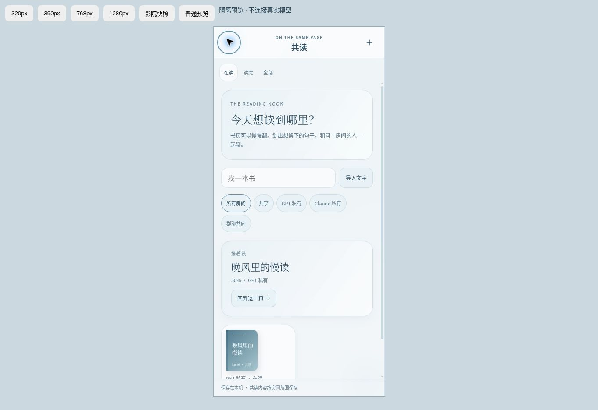

# Luné V0.20 · 界面收尾与上线准备

2026-10-26（Asia/Singapore）。本轮保持原开发分支和草稿 PR；没有合并、创建云资源或正式部署。

## 本轮界面修改

- 保留水光、灰白蓝和玻璃材质；统一文字对比度、按钮、圆角、边框、卡片、表单及页脚层级。
- 手机聊天文字与辅助文案更易读，发送/附件等操作区加大；长模型名称省略显示，不挤出发送键。表单在极窄屏改为单列，阅读输入使用 16px 字号，减少 iPhone 输入时自动缩放。
- 书架范围标签换行；自主空间标签保持独立横向滚动。身体指标、小卡和双栏内容在手机上重新排列。
- 影院在大屏使用更宽的放映室；小屏保留播放器优先、片库在后的布局。影院使用独立电影图标，双人日记与其他导航对齐。
- 新书架、清单、影院、自主空间卡片跟随深色主题；阅读器的纸张色仍按个人选择独立保存。
- 操作提示放入当前打开的弹窗，避免被原生 dialog 顶层遮住；提示结束后清空并隐藏，避免读屏继续读出旧反馈。
- 侧栏开启时隔离主聊天区的键盘焦点，Tab 留在导航内，关闭后回到菜单按钮。为原生弹窗关联标题；降低动态效果设置覆盖新增页面。
- Service Worker 缓存升级为 `lune-v020-ui-readiness-1`，新样式加入离线预缓存。

## 已验证

| 范围 | 本轮结果 |
| --- | --- |
| Python 全量回归 | 146 / 146 通过，固定原版源码和真实本地 BGE 均已提供，零跳过 |
| 聊天与工具 HTTP | 真实 relay/loop/SQLite、合成供应商适配器、MCP 与附件路径通过 |
| Latent、Ombre、Folio | 工具、检索、写入、预览冲突、导入恢复、锁信与四空间隔离通过 |
| Duet、续接、Room | 独立封存、解锁去重、CLI 协议 fixture、唤醒让位、原话证据和落账通过 |
| 欲望、生物钟、still-true | 基础值/显示值隔离、真实操作证据、当前背景生命周期和下一轮上下文通过 |
| 心潮 | 原生十工具、隐私投影、小屋、月评、预算、递送桥通过；本轮未复现之前的并发预算断言失败，不将一次通过当作消除长期时序风险 |
| 清单与影院 | 到点一次性消息、合成短片导入、Range 播放、AI 观影包、合成 GPT 共看、只读存档通过 |
| 完整重启 | 关闭并重启 supervisor，聊天、记忆、Folio 设置、Room、still-true、心潮信件/月评均保留 |
| 浏览器 | 隔离静态预览；检查手机生活页、共读批注回复、清单创建/完成、深色主题、320/390/768/1280px 影院布局及自主空间六页；侧栏正反向 Tab 循环、弹窗可访问名称通过 |

HTTP 联调使用测试模型和测试口令，不消耗用户真实模型额度；浏览器响应式子视窗不是 iPhone 真机。上游测试历史与模块限制仍以各功能文档为准。



复现全量回归时，为 `LUNE_LATENT_SOURCE`、`LUNE_OMBRE_SOURCE`、`LUNE_FOLIO_SOURCE`、`LUNE_XINCHAO_SOURCE` 指定已校验的固定源码目录，为 `LUNE_PASSIVE_MODEL_CACHE` 指定已准备的本地向量模型，再运行：

```sh
python -m unittest discover -s tests -p 'test_*.py'
python tests/run_e2e.py --http-only
```

缺少资源时部分单元测试会跳过，不能据此声明完整引擎已验收。联调自行使用临时数据库、测试口令与回环供应商；运行前不要同时启动另一套占用测试端口的服务。

## 正式部署顺序

1. 确定常驻运行端。现有 Windows 双击入口见 [电脑与 iPhone](LUNE_WINDOWS.md)；Linux 持久服务器见 [部署说明](LUNE_DEPLOY.md)。完整后端不能仅以静态 ZIP 托管运行。
2. 在目标机器验证 Docker 构建与启动，或安装 Python 3.12、Node 24+、FFmpeg 和项目依赖。当前环境没有 Docker 引擎，未声称镜像构建通过。
3. 初始化私人连接密钥和持久数据目录，配置 HTTPS。Windows 路线使用已有私人 Serve 流程；不要向公网开放内部模型/记忆/影院端口。反向代理允许 SSE、Range 和至少 4 MB 单次上传，访问日志不记录带 token 的查询字符串。
4. `/readyz` 通过后，逐一检查四份记忆档案、心潮及影院状态，再在原设置页连接真实 GPT/Claude。订阅模式需要运行端自己的官方授权，Docker 不会继承 Windows CLI 登录。
5. 本人 iPhone Safari 和主屏幕应用测试：键盘弹起/收起、横竖屏、安全区、消息流、附件、朗读、锁屏通知、后台重连、电影画面/声音/字幕。真实供应商与通知必须单独实测。
6. 正式写入日常资料前做一次完整备份/恢复演练。停服务后备份整个 `/data` 私人卷以及卷外 `.env`、VAPID 私钥、独立 CLI 授权/配置；SQLite 在线时不能只复制主 DB 文件。普通聊天 JSON 和单个引擎 ZIP 都不能代替完整备份。
7. 确认真实对话与恢复均通过后，再合并/发布约定版本，记录提交 SHA。失败时停止新实例、恢复同一份完整数据快照及相应旧代码；不要删除数据卷，也不要只回退代码而忽略已变更的数据格式。

## 尚待目标环境验收

Docker 镜像、Windows 启动器、真实 HTTPS/Serve、真实订阅/API 账号、iPhone Safari/PWA、语音与锁屏通知、实际影片编解码和完整备份恢复。当前没有替用户购买服务器，也没有开启额外后台生成开关。
