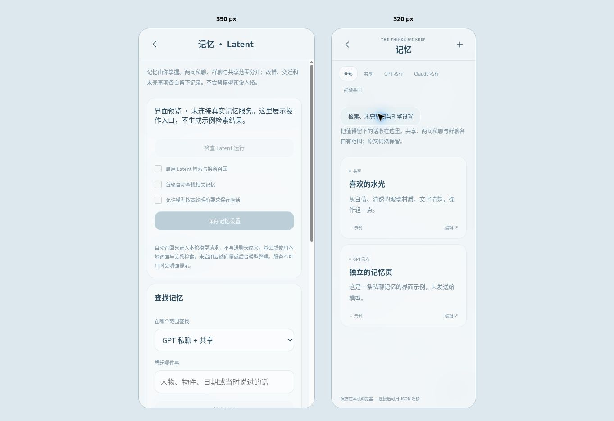

# Luné V0.7 · Latent 记忆接入

> 历史版本：这里记录的简化逐轮召回与零向量依赖已由 [V0.8 原版 Passive Recall](LUNE_V08.md) 替换。当前安装、依赖与运行方式以 V0.8 为准；以下保留当时实现与测试记录。

本版实际使用 Latent 的 `MemoryIndex`（BM25 / 字符 bigram / 关系排序）、只读候选入口、`SessionRecall`、会话快照与格式化函数。它是独立 Python 工作进程；没有把同名的自写检索冒充 Latent，也没有把全库 MCP 直接暴露给两个模型。

来源为用户的 `liyanjun921/Latent-memory`，固定提交 `835250d080c02d9553d3b96d9a2753773a4a0c3c`。Latent 的 PolyForm Internal Use 许可证与 Luné 的 AGPL 分开保留。此仓库、预览和镜像均不包含第三方源码；安装助手在运行端另行获取原版源码，不修改、不重标许可证。版本升级需要重新核对接口与测试。

## 已实现

| 能力 | 本版行为 |
| --- | --- |
| 唯一事实源 | 原有 SQLite 记忆升级，旧记录无需重写。Latent 收到按权限筛选的只读快照，没有另一份会漏删的正文副本。 |
| 范围 | GPT=共享+GPT；Claude=共享+Claude；群聊=共享+群聊。工作进程拿不到其他房间资料。模型只写本房间，共享由用户管理。 |
| 每轮召回 | 在第一条模型请求前进行，单独放在常驻说明之后；不进入聊天表、导出消息或下一轮原始历史。查询候选用原生只读路径，不反复抬高权重。 |
| 换窗延续 | 第一次或距离上次成功回复超过 30 分钟时，调用原生开场召回。上次线索来自实际同房间最后几条，标为自动生成、未经确认的历史快照；不调用额外模型。新鲜度选择只影响开场排序，不删旧记忆。 |
| 主动检索 | `lune_memory/search` 与页面检索。无匹配与服务失败分开报告；显式搜索的原生使用权重写回私人数据库。 |
| 写入 | 模型仅在本轮用户明确要求时维护记忆；必须逐字引用这轮用户原话，后端固定来源消息与房间、复核运行状态。不会从模型自己的叙述制造事实。 |
| 变迁与纠错 | `change` 新增现状并保留前后链；历史查询可沿允许范围内的链回看。`correct` 撤回错误，普通及历史召回均不返回被撤内容。 |
| 用户控制 | 直接编辑、调整范围、删除、登记变迁/纠错、查看修改记录。改范围时断开跨范围的历史链接；删除整条变迁链退出召回。审计版本仍在私人数据库中。 |
| 未完事项 | 独立、持久、有范围与版本的清单；可以添加和标记完成。当前未完事项可随每轮上下文提供，不从历史快照猜测任务仍未完成。 |
| 备份 | 原格式增加记忆状态、变迁链接、当前状态和未完事项；导入重映射 ID 与来源、验证范围和环路。聊天消息仍是原文。完整审计与已删除记录需要备份 SQLite。 |
| 状态 | 页面显示实际安装/开关状态，提供不调用模型的运行检查；回复元数据记录本轮引擎及相关检索 ID。 |

`lune_memory` 是 Luné 的受控适配工具，未直接提供原项目的全库写工具、隐藏自动浮现入口或山屋管理口。常驻记忆规则与用户可空的模型说明分开，不要求初始化十二节人格，也不让模型决定用户有没有权利纠错。

## 安装与运行

需要 Python 3.10+、Git，以及首次可访问 GitHub 的网络。基础检索使用 Python 标准库，不安装 fastembed、jieba 或云端 embedding SDK。

推荐在正式服务器启动参数中设置：

```sh
LUNE_LATENT_AUTO_SETUP=1
# 可选；默认在 RELAY_DB 同级的 lune-private/latent-source
LUNE_LATENT_SOURCE=/data/lune-private/latent-source
```

`scripts/run_lune.py` 会在首次启动时调用独立安装助手，获取固定版本并校验，之后重复启动只核对现有源码；安装失败不会悄悄下载其他版本。也可以先运行：

```sh
python scripts/setup_latent.py --destination /data/lune-private/latent-source
```

随后按原部署步骤启动 Luné。在「记忆 → 检索、未完事项与引擎设置」或设置中的记忆管理，运行检查，再查看开关。原有记忆默认可供检索，不需要重新复制；用户原本明确保存为共享的内容仍为共享。

iPhone 只打开同一个 HTTPS 前端，Python 和 Git 在服务器运行。静态私人预览只能看界面与本机资料，不能运行真实 Latent 或提交模型请求。此轮未创建新的公网 Python 服务器，也没有登录真实订阅账户。

工作进程只接收已经筛选的资料与查询；以隔离 Python 模式启动，不继承模型密钥、代理和 Python 环境钩子，12 秒超时会终止并回收进程。固定源码的文件集与哈希在运行前校验。记忆文件、工作数据库和运行源码放在私人目录；不添加到通用 MCP 列表，也不传到模型附件。

## 验证与限制

53 项 Python 测试通过，其中新增 17 项记忆集成测试（涉及检索的用例使用实际固定版本的 Latent）。覆盖所有者鉴权、设置版本、私聊/群聊隔离、原话与来源、停止后拒绝写入、变迁与撤回、改范围、删除链、备份重映射/失败回滚、在途修改使旧投影失效、无命中与不可用分离、请求内召回、关闭自动召回后仍能主动检索。

浏览器检查桌面记忆页与引擎入口，并用 390px / 320px iframe 检查面板、范围选择和横向溢出（两种宽度均无横向溢出）。这不等于 iPhone Safari 真机测试。预览保持未连接提示，不伪造检索命中或运行状态。



隔离 HTTP 联调实际跑通：合成模型发出记忆工具调用 → 后端保存原话 → 原生 Latent 检索 → 下一轮自动带入 → 回复元数据记录命中；群聊不返回私聊记忆。同时回归 GPT/Claude 群聊顺序、附件、MCP、持久待办及 MiniMax/ElevenLabs 朗读。未使用真实模型/语音凭据。

```sh
LUNE_LATENT_SOURCE=/path/to/verified/latent-source python -m unittest discover -s tests -p 'test_*.py'
LUNE_LATENT_SOURCE=/path/to/verified/latent-source python tests/run_e2e.py --http-only
```

未配置源码时，真实引擎测试会明确跳过；其余测试仍可运行，不能把跳过写成实际引擎通过。

当前是零依赖词面与关系检索，不是真语义向量；未启用云端/本地 embedding、原项目的隐藏 Passive Recall、后台模型归档、人格编译、自动升级人格或 Claude 会话裁剪。我们的每轮召回使用原生只读候选入口，是独立的 Luné 宿主接线。记忆写入是用户明确要求下的原话保存，不是未经确认地自动总结每句话。

当前每个视图最多 2000 条有效/历史记录；超过会明确失败，不偷偷只查前几条。按查询返回有限候选，历史链最多返回 50 条；提示材料有长度上限并标截断。合成测试不等同于真实长期语料的准确率或规模性能；返回相关记忆不保证它回答了问题。正式订阅账号、iPhone Safari 真机与 Docker 镜像仍待正式环境验收。
