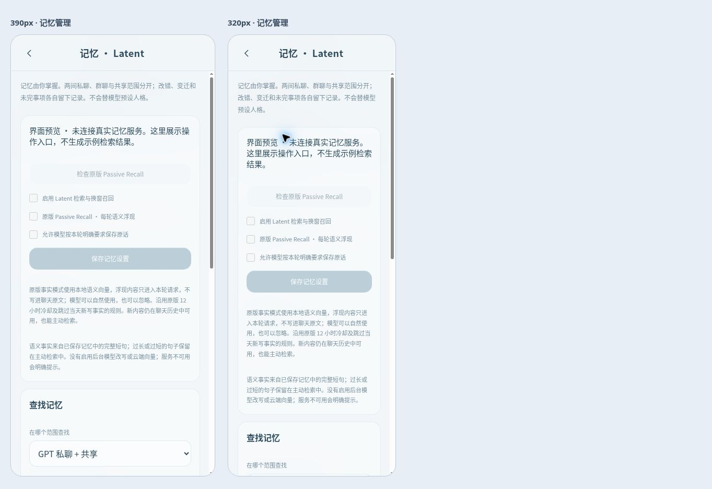

# Luné V0.8 · 原版 Passive Recall 接入

V0.7 只接了原生主动检索与换窗召回，逐轮召回用了 Luné 自己的词面候选流程；该范围不完整。本版删除这个逐轮替代分支，在实际 `build_messages` 路径调用 Latent 原版隐藏入口与原生临时宿主。原有开启的自动召回开关现在控制这条原版路径，不需要另建记忆库。

## 实际运行的内容

分别安装的 Latent 固定版本为 `835250d080c02d9553d3b96d9a2753773a4a0c3c`，原版源码未修改。本仓库的宿主适配器使用 `MemoryServer.handle(..., hidden_ok=True)` 调用 `latent_passive_recall`，配合原生 `PassiveRecallService`、`FactIndex`、`FactCooldown`、`FactVectorCache` 与 `PassiveRecallAdapter`。该隐藏入口不会出现在模型可调用的工具列表。

事实模式使用原生 `LocalProvider` 及本地 CPU 模型 `BAAI/bge-small-zh-v1.5`（512 维）。安装时下载公开权重与 tokenizer，运行时只使用本地文件；没有向量 API、没有额外聊天调用。宿主以 `o200k_base` 参考编码控制注入预算，不把它当作所有模型的精确计费计数。

每条用户消息先选出共享与当前房间的授权记忆，再交给隔离工作进程；GPT、Claude、群聊分别维护视图和冷却状态。原版执行低信息筛选、相似度下限、事实来源验证、前两条事实及有限同块补充、12 小时冷却。沿用原版跳过当天新写事实的规则，写入日期按北京时间取日；当天的聊天仍在当前历史中可用，也能主动检索。未修改原版的阈值来迎合测试结果。

原版宿主只拿当前用户文本做准入与组装，生成临时材料；Luné 把该材料放在实际模型请求的当前用户消息之后、随后群聊回复之前。多模态附件及现有聊天顺序保留。只在本轮请求副本出现，不写入聊天原文、导出消息或下一轮原始历史。模型规则要求先回应当下，可以自然使用或忽略候选，不逐条复述、不汇报查库、不强行关联，也不让材料规定人格。

## 原话事实投影及用户控制

SQLite 仍是唯一可编辑的事实源。Luné 将保存内容按完整句子/换行提取 8–120 字的原话，生成原版可读的派生事实文件，绑定原记忆 ID 与写入日期。不会截断长句制造新事实、不会让模型改写事实，也没有接入原版后台 LLM 事实回填。超出长度的句子仍保留在主动检索中，所以当前语义覆盖不等于全文覆盖。

私人目录会保存可重建的事实投影、向量缓存及冷却文件；它们不是第二份可独立编辑的记忆。每轮根据内容版本和状态重建需要更新的投影；编辑、移动、纠错或删除后，下次请求重新核验来源。在途修改使整个旧投影失效。删除记录退出召回，审计仍保留在私人 SQLite。模型写入仍要求本轮用户明确要求并逐字引用原话，只能写本房间；共享由用户管理。

稳定的回合/模型投递 ID 让同一轮重试返回同一投递；新的回合服从原版冷却。工作进程常驻复用本地模型，关闭服务时取消任务并回收进程及管道。单次调用有 30 秒外层上限，原版宿主 fetch 有 2 秒预算；检查使用独立进程，避免另留一份常驻模型。工作进程不继承应用的模型密钥、代理或 Python 钩子。

关闭自动浮现后仍能主动检索与换窗召回。缺少本地资源、加载失败或来源在途变化时，明确标记召回未完成，不改走 V0.7 的简化逐轮召回，也不能据此声称过去没有记忆。

## 安装与运行

在运行两个 Python 服务的服务器安装 `backend/requirements.txt` 与 `examples/requirements.txt`。后者现包含 fastembed、jieba、tiktoken 及代理兼容依赖。首次启动需要能下载固定源码、公开向量模型和 tokenizer，运行时使用本地缓存。

推荐设置 `LUNE_LATENT_AUTO_SETUP=1`，再按 [原部署步骤](LUNE_DEPLOY.md) 启动 `scripts/run_lune.py`。助手会检查固定源码、准备缺少的本地资源；失败会停止安装，不下载未经核对的其他源码版本。资源与状态放在持久私人卷内：

```sh
LUNE_LATENT_AUTO_SETUP=1
LUNE_LATENT_SOURCE=/data/lune-private/latent-source
LUNE_PASSIVE_MODEL_CACHE=/data/lune-private/latent-models
# 可选；默认在 RELAY_DB 同级的 lune-private/passive-state
LUNE_PASSIVE_STATE_DIR=/data/lune-private/passive-state
```

也可事先独立运行：

```sh
python scripts/setup_latent.py --destination /data/lune-private/latent-source --vectors --model-cache /data/lune-private/latent-models
```

在记忆管理中点击“检查原版 Passive Recall”，会实际加载本地模型并检查 512 维输出，不调用付费服务。状态页的“资源就绪”只说明资源在位，不能代替这个运行检查或本轮回复元数据。iPhone 使用 HTTPS 前端，Python 和模型运行在服务器。

Latent 的 PolyForm Internal Use 许可证与本仓库 AGPL 分开保留。原版源码、公开模型权重及私人派生数据都不打包进本仓库、静态预览或 Docker 镜像；运行端独立安装。本轮没有新建公网 Python 服务，私人界面预览继续明确显示未连接真实记忆服务。

## 本轮验证

59 项 Python 测试通过，其中 6 项新增集成用例使用真实本地 BGE 向量和未修改原版源码，覆盖正式 context 隐藏入口、范围隔离、重复投递、跨进程冷却、编辑删除移动、同日规则、低信息、关闭开关、缺少资源，以及实际模型请求与原始历史/导出的分离。回收后台进程后不再出现事件循环已关闭的退出异常。

浏览器复核新版入口与说明，并在 390px / 320px iframe 内检查面板和文档无横向溢出。预览明确未连接真实服务，运行按钮与开关禁用，没有伪造命中。此检查不等于 iPhone Safari 真机验收。



隔离 HTTP 联调跑通：合成模型调用记忆工具 → 后端保存用户原话 → 将仅用于测试的记录设为三天前 → 下一轮经过原版隐藏入口 → 实际发往合成供应商的 HTTP 请求含原生材料 → 再下一轮命中冷却。群聊不带入私聊记忆；附件、MCP、生活页、MiniMax / ElevenLabs 回归通过。没有调用真实聊天、订阅或付费语音服务。

```sh
LUNE_LATENT_SOURCE=/path/to/latent-source LUNE_PASSIVE_MODEL_CACHE=/path/to/latent-models python -m unittest discover -s tests -p 'test_*.py'
LUNE_LATENT_SOURCE=/path/to/latent-source LUNE_PASSIVE_MODEL_CACHE=/path/to/latent-models python tests/run_e2e.py --http-only
```

资源缺失的环境会跳过真实引擎用例，不能记为通过。独立探针的 [原始联想测试](LUNE_PASSIVE_RECALL_TEST.md) 仍有弱关联和漏召回：本地模型下未重标定原版 0.42 下限，接入成功不能证明“自然接话”质量。规则已允许忽略素材，但仍需用正式订阅账号进行真实多轮对话验收；iPhone Safari 真机、正式服务器资源消耗及 Docker 镜像也尚未验收。
