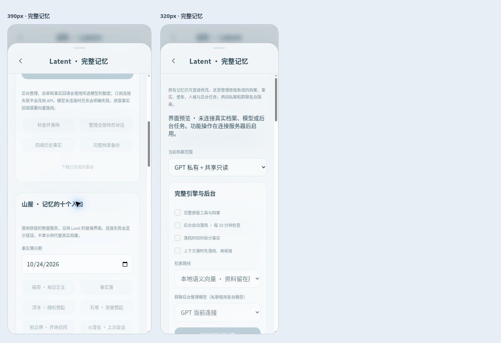

# Luné V0.9 · Latent 完整产品功能接线

本版对照 Latent 固定提交 `835250d080c02d9553d3b96d9a2753773a4a0c3c` 的 README、工具参考及实现，补上 V0.8 之外的原生工具、持久档案、后台任务和所有者入口。上游 main 核对时仍指向该提交。安装端独立获取源码，本仓库没有复制第三方实现、山屋素材或其演示数据，许可证各自保留。

“完整”指下表覆盖公开产品能力及其宿主接线。依赖供应商、用户资料或 Claude Code 运行端的能力，保留真实前提和未验收状态；不宣称用户的所有在线功能已经启用。研究实验脚本不作为聊天产品开关，原版自检与命令入口另行保留。

## 逐项对照

| 原版能力 | Luné 接线 | 本轮证据或依赖 |
| --- | --- | --- |
| `latent_session_start` | 实际模型请求前原生开场召回，便条、未解决、会话快照、最近记忆；保留缺少正常收尾时的原生自动快照 | 工具与持久收尾集成测试；自动快照标为未经确认 |
| `latent_search` | 原生 BM25 / 语义 / 关系融合、权重持久化、`queryVariant` 及历史变迁链 | 原版处理器、实际来源与范围测试 |
| `latent_append` | 原生正文、当下状态、索引证据、预检、索引修补与增量事实 | 真实原版写回与 preflight；后台 HTTP 写入 |
| `latent_supersede` | 原生新事实与变迁链、仅补链模式，私人模型不得修改共享来源 | 原版变迁历史及共享写保护测试 |
| `latent_correct` | 原生撤回账本、纠错新记录与相关块提醒；所有者可直接提交 | 私人/共享撤回和原有来源保护测试 |
| `latent_cleanup` | 原生预览令牌、来源快照检查、精准清理与回收副本 | 集成测试实际预览、删除、再次检索 |
| `latent_unresolved` | 原生新增、修改、关闭和当前清单 | 工具与山屋地图使用同一原生存储 |
| `latent_thread_close` | 持久原生会话收尾、未解决复核和续接检查点 | 收尾、开场与续接检查点测试 |
| Passive Recall | 原生隐藏入口、临时宿主、块模式/事实模式和源状态检查；普通 MCP 与模型工具列表都看不到隐藏入口 | 原版事实生命周期、本地真实向量；V0.8 兼容召回测试继续保留 |
| `latent_fact_backfill` | 原生 status / next / submit / finish、校验、全量与增量去重；提供后台回填任务 | 真实 BGE 下拆块、提交、finish；HTTP 后台批次 |
| 后台落档 | 原版 `background_archive.run_once/flush`：批次、初稿、自审、形状闸、事实拆条、游标和在途恢复 | 工具为空的合成模型实际 HTTP；真实整理质量待账号验收 |
| 人格初始化 | 原版 inspect / extract / choose-sections / preview / questionnaire / answers / confirm / route / ship 九个入口；有历史编译与冷启动是不同流程 | 原版发布自检，宿主 HTTP 跑通原文件直用的 inspect → route → ship；问卷/章节/逐条确认有表单 |
| 人格完整注入 | 正式出货成品逐字整块进入请求，每次重读；没有就保持现有空白/自定义设置，不编人格 | 空白、前后空白、完整文件和更新后再读测试 |
| 历史导入 | 原版 `load_any` 和 `write_corpus`：ChatGPT、Claude、Claude 项目/记忆、支持的聊天文本与 Markdown | 原版解析器自检；HTTP 实际导入 Markdown；相同文件按哈希防重 |
| 山屋 | 原生 AdminAPI 的磁带、事实簿、浮冰、石堆、拍立得、火漆信、地图、护照、天气、小锁信全部有 Luné 面板入口 | 原版数据接口逐项测试；保留本项目玻璃 UI，不载入演示数据 |
| 便条回信 | 原生 NoteStore、开场递送与 `latent_note_reply` | 真实便条、新会话递送、declined 回执测试 |
| 三条检索路线 | 零依赖、本地模型、可选云端；默认本地。云端须所有者配置供应商与数据去向确认 | 本地与零依赖实际测试；云端适配器原版自检，真实第三方供应商未验收 |
| 诊断与观测 | 原版 doctor、健康统计、召回日志和任务回执；失败与无命中分开 | 原版只读诊断、山屋健康与日志测试 |
| API 上下文续接 | 需要缩短请求时先 flush，核对游标覆盖，再存原生检查点；留尾部完整原话并从用户发言切入；SQLite 原文不删除 | HTTP 先落档/检查点联调；字符预算是 Luné 宿主策略，不冒称原版 Claude token 策略 |
| Claude Code 原地续接 | 连接端入口原样运行 `forge_session.py`，保留原版真实用量、thinking、父链、工具先例与失败不裁策略 | 原版 forge 自检通过；用户的真实 Claude Code 会话尚未连接/恢复验收 |
| MCP / 客户端连接 | 服务器提供鉴权原生 MCP POST 网关；连接端可运行原版 stdio / Streamable HTTP、Claude hook、参考宿主 | 本轮 HTTP 原生工具握手与调用；各外部聊天客户端没有借用此结果当作真机通过 |
| 完整备份 | 当前原生档案目录的语料、状态、人格、事实、便条、会话、初始化历史与后台账本 ZIP；SQLite 继续按原办法备份 | 实际生成并通过鉴权下载 ZIP；完整迁移还需 SQLite 与密钥的独立私人备份 |

## 数据与所有者控制

原有 SQLite 记忆继续作为原有记录的唯一编辑源；原版索引每轮接收当前授权范围的只读快照，不再另写一个可独立修改的旧副本。新增原版记录由原版 Markdown 语料与 sidecar 账本作为唯一事实源，原有编辑器不冒充能编辑它；完整面板可以查看原文、直接登记纠错，原生精准清理仍走预览令牌。两种来源会一同进入原生主动检索。

GPT / Claude / 群聊 / 共享各有原生工作目录。私聊读取自身与共享；模型只能改自身目录，不能借引用共享记录的 ID 或原话改共享。共享撤回与变迁账本在读取时合并，避免私聊继续看见已撤回的共享来源。原有 SQL 记忆的原生引用只能读，修改回到原编辑器。工作进程收不到 SQLite 路径或模型密钥。

后台私聊整理始终使用各自模型：Claude 私聊不能交给 GPT；群聊的后台模型可以选择。群聊原文仍保存在 SQLite；本轮合成测试不代替多角色主语归属的真实质量验收。聊天模型写入受原有 `model_writes` 开关和运行状态约束；后台任务有单独开关，由所有者启动的手动任务独立执行。

原版 Passive Recall 对原有保存记忆保留 V0.8 的原话短句兼容路径；新增原生语料使用原生块路径，在事实全量建立后由原版切入事实模式。模型可回填更长原文，不再只受 V0.8 短句投影覆盖限制。工具返回后撤去本轮旧的临时浮现块，避免把已更正材料继续作为后续请求的自动注入。

## 运行与手机入口

仍使用 [原部署方式](LUNE_DEPLOY.md)，开启固定源码与向量资源安装：

```sh
LUNE_LATENT_AUTO_SETUP=1
LUNE_LATENT_SOURCE=/data/lune-private/latent-source
LUNE_PASSIVE_MODEL_CACHE=/data/lune-private/latent-models
LUNE_LATENT_FULL_DIR=/data/lune-private/latent-full
```

完整服务面向 Linux 运行端，使用文件锁串行保护原生语料；iPhone 只打开同源 HTTPS 页面。`LUNE_LATENT_FULL_DIR` 必须在持久私人目录中。不要把它放在静态网页目录、附件目录或公开 Git 仓库，也不要将派生缓存当作独立编辑源。

入口为“记忆 → 检索、未完事项与引擎设置 → 打开完整 Latent”。默认启用完整原生工具、本地检索、后台落档、落档拆事实和上下文续接；后台每 10 分钟检查一次，沿用原版 60 条 / 90 分钟 / 跨日 / 30000 字门槛，不是每次检查都调用模型。后台生成、自审与事实回填会消耗所选模型的额度；没有连接就明确失败。订阅错误不改走 API。

后台任务单独运行，正常聊天工具仍由短调用工作进程处理；任务回执持久化，重启将未完成的任务标为中断，原版落档游标与在途原稿保留。停止任务会回收本地任务进程组；工具为空的模型请求监测断连并取消，不能承诺供应商已接收的远端计算立即停止。

初始化流程保留原版所有门槛。已有原文件可选择原文直接使用；十二节编译要逐节决定；冷启动问卷可留空，逐条确认不默认 keep。每次步骤前保留初始化状态副本。只有成功 ship 的 persona.md 才激活到模型请求，不手动复制 preview 绕过检查。复杂来源映射仍保留结构化数据入口；真实个人资料需要所有者在页面或后续开发会话中确认。

云端向量是显式可选项，需要服务器设置 `LUNE_LATENT_CLOUD_CONSENT=1`、`MEMORY_EMBED_MODEL`、`MEMORY_EMBED_ENDPOINT`、`MEMORY_EMBED_API_KEY_ENV` 及其指向的密钥变量，再在页面选择 cloud。会将查询和授权范围的被检索内容发给该供应商；默认本地不需要这些参数。密钥只进入选择该路线的隔离工作进程环境，不进页面、MCP 配置、任务回执或备份。

连接端可使用原版全部相关入口，示例：

```sh
python scripts/latent_tools.py forge-session check /private/claude-session.jsonl
python scripts/latent_tools.py archive --help
python scripts/latent_tools.py initialize --help
python scripts/latent_tools.py mcp --help
```

这些命令保留原版选项与失败检查，不替 iPhone 安装 Claude Code，也没有在本轮登录用户订阅账号。Claude 订阅对话运行时仍保持之前的未接通状态；保留原版 forge 入口不能被写成该运行时已经完成。

## 验证与交付界限

69 项 Luné Python 测试通过，新增 10 项完整原版集成测试，覆盖十工具与隐藏边界、预检写入、变迁纠错、精准清理、来源保护、共享撤回后的读取、便条与收尾、山屋接口、真实 BGE 事实回填，以及完整人格重读。原有 59 项继续回归。

真实本地 HTTP + SQLite 联调使用合成供应商，跑通原版后台初稿/自审/事实 → 原版写回 → 游标推进 → 主动检索、导入、ZIP 下载、人格 inspect / route / ship、后台回填，以及先落档再写续接检查点。模型工具为空；没有调用用户真实聊天、订阅或付费语音服务。原版自检报告记录 32 项通过、零失败、零超时，精简记录在 [自检记录](native-full-release-checks.json)。

原版自检期间有一次非必要 Microsoft 遥测连接被自动审批拒绝，未获准放行或绕过。原版进程仍生成了完整测试结果；Luné 本地向量初始化与安装助手现显式关闭 ONNX Runtime telemetry。这个结果不代表已经对所有上游依赖做完整网络审计。

浏览器检查 390px / 320px 面板无横向溢出；预览不伪造档案、运行结果或模型连接。私人静态预览不能运行 Python 后台。真实订阅账号、云端向量供应商、长期语料自然接话效果、Claude Code 真会话恢复、iPhone Safari 真机及正式服务器的资源表现仍待对应环境验收。



```sh
LUNE_LATENT_SOURCE=/path/to/latent-source LUNE_PASSIVE_MODEL_CACHE=/path/to/latent-models python -m unittest discover -s tests -p 'test_*.py'
LUNE_LATENT_SOURCE=/path/to/latent-source LUNE_PASSIVE_MODEL_CACHE=/path/to/latent-models python tests/run_e2e.py --http-only
```
